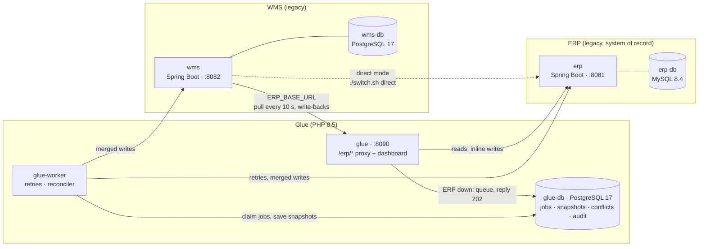
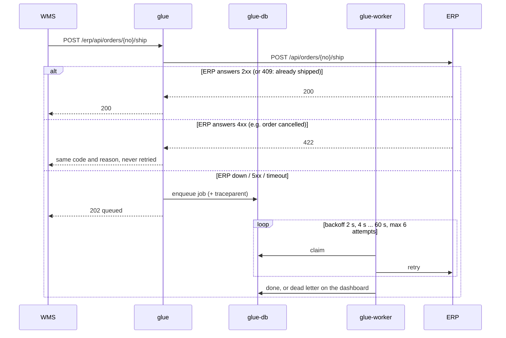
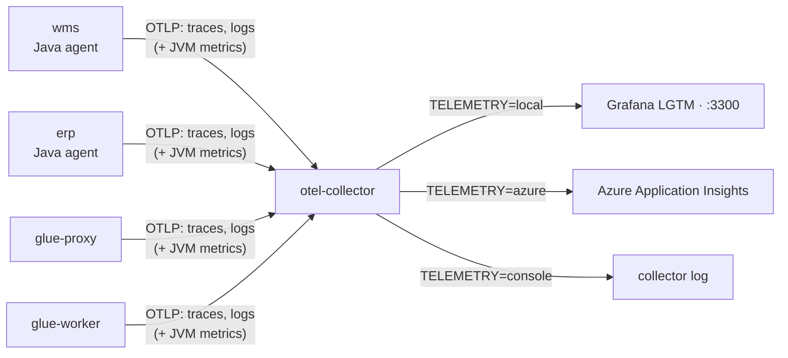

# ERP ⇄ WMS Glue Service

A small integration service in **PHP 8.5** that keeps a legacy ERP and a legacy warehouse management system (WMS) in sync in both directions. It handles field-level conflicts, retries, partial failures and drift, and neither system's code changes.



## Services

| Service | Stack | Host port | Role |
|---|---|---|---|
| `erp` | Java 21, Spring Boot | 8081 | System of record for customers, products, prices and sales orders |
| `erp-db` | MySQL 8.4 | none | ERP database |
| `wms` | Java 21, Spring Boot | 8082 | Warehouse app: stock, bins, shipments; local copy of ERP master data |
| `wms-db` | PostgreSQL 17 | none | WMS database |
| `glue` | PHP 8.5 | 8090 | ERP-compatible proxy for the WMS + operations dashboard |
| `glue-worker` | PHP 8.5 | none | Job processor (retries, dead letters) + periodic reconciler |
| `glue-db` | PostgreSQL 17 | none | Job queue, sync snapshots, conflicts, audit log |
| `otel-collector` | OpenTelemetry Collector | none | Single telemetry endpoint for all services |
| `lgtm` | Grafana + Loki + Tempo + Prometheus | 3300 | Local telemetry backend (only when `TELEMETRY=local`) |

### ERP (`erp/`)
Classic monolith REST API: UPPER_CASE JSON, full-record `PUT`s, a `ROW_VER` counter that increases on every change, no change feed and no optimistic locking.

| Endpoint | Purpose |
|---|---|
| `GET/PUT /api/customers[/{code}]` | Customer master (PUT replaces the full record) |
| `GET/PUT /api/products[/{sku}]` | Product master and price |
| `PUT /api/products/{sku}/stock` | Post a stock level (`422` if the product is `BLOCKED`) |
| `GET/POST /api/orders`, `GET /api/orders/{no}` | Sales orders (`?status=OPEN`) |
| `POST /api/orders/{no}/ship` · `/cancel` | Confirm shipment (`409` already shipped, `422` cancelled) / cancel |

### WMS (`wms/`)
- Every 10 s it pulls products, customers and open orders from `ERP_BASE_URL`. A row is copied only when the ERP's `ROW_VER` is higher than the one stored locally.
- It owns stock and shipments, and writes back to the ERP synchronously when stock is adjusted, an order ships or a delivery address is corrected.

| Endpoint | Purpose |
|---|---|
| `GET /api/items[/{sku}]`, `PUT /api/items/{sku}` | Items with stock and bin |
| `POST /api/items/{sku}/adjust` `{"delta":-3}` | Stock adjustment → posts the new level to the ERP |
| `GET/PUT /api/partners[/{erpRef}]` | Customer copy; the PUT sends the full record to the ERP |
| `GET /api/orders`, `GET/POST /api/shipments` | Orders received from the ERP; ship one (`{"orderNo","trackingNo"}`) |

Both legacy systems also expose `GET/POST /admin/chaos` `{"failRate":0.3,"latencyMs":2000}` for fault-injection testing. It returns random `503`s and adds latency on `/api/*`.

### Glue (`glue/`)
Plain PHP 8.5: PDO, curl and no framework, using PHP 8.5 features such as the pipe operator.

| Path | Purpose |
|---|---|
| `/erp/*` | The ERP API as the WMS sees it |
| `/` | Dashboard: queue stats, conflicts, dead letters, live ERP/WMS comparison, audit log |
| `POST /reconcile`, `/jobs/{id}/retry\|discard`, `/conflicts/{id}/resolve`, `/chaos` | Dashboard actions |
| `/health` | Liveness |

## Getting started

Requires only Docker with Compose v2. JDK, Maven and PHP live inside the images: `erp` and `wms` are built from source by a multi-stage Maven Dockerfile (the OpenTelemetry Java agent is added in the same step), and `glue` is the official `php:8.5-cli` image plus `pdo_pgsql`. CI (`.github/workflows/build.yml`) builds all images and runs the tests on every push.

```bash
docker compose up -d --build     # first build downloads Maven deps, ~2-3 min
open http://localhost:8090       # glue dashboard
open http://localhost:3300       # Grafana (telemetry)
```

Mode and telemetry destination come from `.env`. Change them with `./switch.sh`; the only value you edit by hand is the Application Insights connection string.

## Enabling / disabling the glue service

```bash
./switch.sh glue      # WMS → glue → ERP   (starts glue, glue-worker, glue-db)
./switch.sh direct    # WMS → ERP          (stops the glue; original point-to-point integration)
./switch.sh           # show current settings
```

The integration needs exactly one change: the WMS setting `ERP_BASE_URL` (the `WMS_ERP_URL` variable in `.env`), which points either at `http://erp:8080` or at `http://glue:8080/erp`. On a real installation this is the WMS config entry, the API gateway route or the DNS record for the ERP host. Neither application is rebuilt or modified.

`./switch.sh direct` stops the glue services; their database volume is kept. On re-enable, the first reconcile sweep catches up on everything that diverged in the meantime.

## Initial feed

At first start every database is created and seeded from its init script:

| Script | Contents |
|---|---|
| `erp/db/01-schema-and-seed.sql` | 8 customers, 10 products (one `BLOCKED`), 7 sales orders (open, shipped, cancelled) |
| `wms/db/01-schema-and-seed.sql` | Copy of the ERP master data as pulled earlier, plus WMS-only data (bins, shipments) |
| `glue/schema.sql` | Empty queue, snapshot, conflict and audit tables |

The seed represents an installation that has been running point-to-point for a while, with the usual drift: stock counts never posted, a delivery address corrected only in the WMS, a shipment whose ERP confirmation was lost, and an order cancelled in the ERP that the WMS still has open.

When the glue starts:
1. The worker queues a full reconcile right away, then one every `RECONCILE_EVERY` seconds. If a system isn't up yet, the sweep is retried with backoff.
2. For any record the glue has never seen, the ERP's current state becomes the baseline (the ERP is the system of record). Differences are then resolved with the ownership rules below. Stock goes from the WMS to the ERP, the WMS-side address correction goes to the ERP, and the missing shipment confirmation is re-sent.
3. Records that cannot be synced (e.g. stock for the `BLOCKED` product) become individual jobs. They end up in the dead-letter queue on the dashboard and the rest of the sweep continues.
4. From then on, the agreed state of each record is stored in `snapshots` and serves as the base for the three-way merge.

To start over with clean data: `docker compose --profile glue --profile lgtm down -v && docker compose up -d`.

## Sync rules

The field ownership in `glue/src/sync.php` (`MAP`) also handles naming between the systems: the ERP's `ADDR_LINE1` is `address` inside the glue and `shipAddress` in the WMS.

| Entity | Field | Owner | Meaning |
|---|---|---|---|
| customer | name, email | erp | ERP wins; WMS edits are reverted |
| customer | address, city | shared | Three-way merge; real conflicts go to a person |
| product | name, price | erp | ERP wins |
| product | stock | wms | WMS wins (posted to the ERP stock endpoint) |
| order | shipment | wms | WMS shipments missing in the ERP are re-sent |

**Three-way merge, per field.** The base is the last value both systems agreed on.
- Both sides are equal: in sync.
- Only one side changed: that change is copied to the other side.
- Both changed a shared field to different values: a **conflict**. Neither system is overwritten, the base is kept, and both values are shown on the dashboard so a person can choose.

Because the ERP only accepts full-record writes, the glue always sends *current ERP state + changed fields*. The WMS's stale full record can therefore never overwrite newer ERP data (the lost-update problem of the direct integration).

## Reliability model

| Concern | Handling |
|---|---|
| ERP slow or down | Writes from the WMS are tried inline first. On a 5xx, connection error or after `INLINE_BUDGET` seconds (well inside the WMS's own 5 s timeout) they are queued, and the WMS gets `202`, so it never fails or needs a manual retry. |
| Business errors | ERP `4xx` (cancelled order, validation) is returned to the WMS immediately with the real reason, and is never retried. |
| Retries | Exponential backoff with jitter (2 s, 4 s, 8 s … max 60 s), `MAX_ATTEMPTS` (default 6), then the dead-letter queue. |
| Ordering | Jobs for the same record run strictly in order. A newer write to a queued record replaces the queued value instead of piling up behind it. |
| Partial failures | A failing record during a sweep becomes its own job; the rest of the batch proceeds. Each handler is idempotent. |
| Worker crash | The container restarts. Jobs left `running` for more than 2 minutes are handed back. |
| Changes behind the APIs' back | The reconciliation sweep compares full data sets, so direct database edits and missed pulls are caught too. |
| Glue itself down | The WMS's write-backs fail as they did before the glue. The next sweep repairs stock, addresses and shipments. |

A write from the WMS through the glue:



### Operations
- **Dashboard (`:8090`):** live comparison of both systems, with disagreements highlighted.
- **Conflicts:** resolve by keeping the ERP or the WMS value. The choice is written to both systems through a retried job.
- **Dead letters:** retry them after fixing the cause, or discard them.
- **Fault injection:** a panel per system.
- **Logs:** `docker compose logs -f glue-worker` shows every attempt, retry and dead letter; `audit` holds the change history.

## Centralised telemetry

All services send traces and logs (the Java agents also send JVM and HTTP metrics) over OpenTelemetry (OTLP) to `otel-collector`. The destination is one switch:




```bash
./switch.sh telemetry local     # Grafana LGTM on http://localhost:3300 (Explore → Tempo / Loki)
./switch.sh telemetry azure     # Azure Application Insights
./switch.sh telemetry console   # collector log only: docker compose logs otel-collector
```

**Azure Application Insights:** copy the resource's connection string (Azure portal → Application Insights → Overview) into `.env` as `APPLICATIONINSIGHTS_CONNECTION_STRING=InstrumentationKey=...;IngestionEndpoint=...`, then run `./switch.sh telemetry azure`. Requests, dependencies, traces and the application map show up as `wms`, `glue-proxy`, `glue-worker` and `erp`.

**What is captured:**
- **ERP and WMS:** the OpenTelemetry Java agent, attached through `JAVA_TOOL_OPTIONS` with no code change. It records HTTP server and client calls, JDBC queries, JVM metrics and application logs.
- **Glue:** request, job and HTTP-client spans, plus every log line. It uses a small dependency-free OTLP client (`glue/src/otel.php`).
- **Propagation:** the W3C `traceparent` header is passed on at every hop and stored with each queued job. A WMS shipment, the glue's `202`, the later retries and the final ERP call therefore all appear in **one trace**.

Other backends (Datadog, Elastic, Splunk, New Relic, any OTLP endpoint) only need a new file in `otel/` with the matching exporter. To add one, copy `otel/local.yaml`. Set `OTEL_SDK_DISABLED=true` in `.env` to switch off the Java agents.

## Deployment

The glue is stateless apart from its PostgreSQL database, and runs anywhere PHP 8.5 runs:
- **On-premise with Docker:** this compose file, or just the `glue`, `glue-worker` and `glue-db` services next to existing systems, with `ERP_URL` and `WMS_URL` pointing at them.
- **Dedicated VM, no containers:** PHP 8.5 CLI with `pdo_pgsql` and `curl`, plus two systemd units: `php -S 0.0.0.0:8080 public/index.php` and `php bin/worker.php` with `Restart=always`. Apply `glue/schema.sql` once.
- **Cloud:** the same image runs on Azure Container Apps or App Service. Azure Database for PostgreSQL replaces `glue-db`, and telemetry goes to Application Insights as above.

### Glue configuration

| Variable | Default | |
|---|---|---|
| `ERP_URL` / `WMS_URL` | `http://erp:8080` / `http://wms:8080` | Upstream systems |
| `GLUE_DSN` | `pgsql:host=glue-db;dbname=glue` | Glue database |
| `RECONCILE_EVERY` | `30` | Seconds between sweeps |
| `MAX_ATTEMPTS` | `6` | Attempts before a job is dead-lettered |
| `INLINE_BUDGET` | `3` | Seconds an inline write may take before it is queued; keep it below the WMS's own ERP timeout (5 s) |
| `OTEL_EXPORTER_OTLP_ENDPOINT` | `http://otel-collector:4318` | Empty disables glue telemetry |
| `OTEL_SERVICE_NAME` | `glue-proxy` / `glue-worker` | Name in the telemetry backend |

## Tests

```bash
docker compose run --rm --no-deps glue php -d zend.assertions=1 tests/merge_test.php
```

## Limits and next steps

- The dashboard and its actions have **no authentication**. Put it behind the corporate reverse proxy or SSO before exposing it beyond the server.
- The built-in PHP web server is enough for one site at moderate volume. For higher load, use FrankenPHP or nginx + php-fpm (same code).
- There is one worker process. Jobs are safe to scale out (`SKIP LOCKED` plus per-record ordering); concurrent sweeps would need an advisory lock first.
- Each sweep scans all records. Past roughly 10k rows per entity, switch to `ROW_VER` cursors.
- New records created by the WMS itself are not mapped. Every record currently starts in the ERP.

## Layout

```
compose.yaml  .env  switch.sh  .github/workflows/build.yml
erp/    Spring Boot app, Dockerfile, db/ seed
wms/    Spring Boot app, Dockerfile, db/ seed
glue/   public/index.php (proxy + dashboard) · bin/worker.php · src/sync.php (mapping, merge, queue, reconcile)
        src/otel.php · src/dashboard.phtml · schema.sql · tests/
otel/   collector config: base.yaml + one file per destination
```
